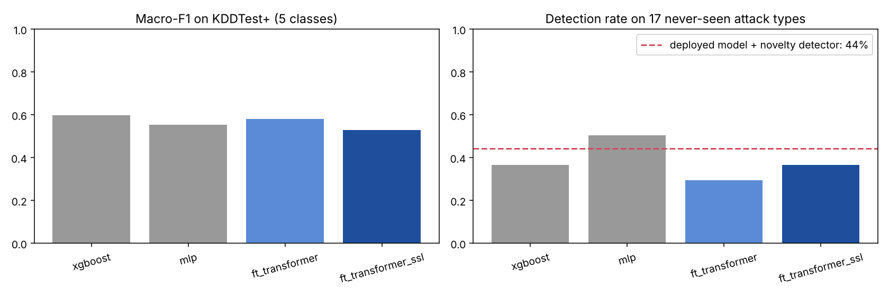

# Cyber Defense: Intrusion Detection, Zero-Day Novelty Detection and an Agentic SOC Triage Assistant

> **Mission:** A federal Security Operations Center (SOC) drowns in alerts and is most exposed to attacks it has
> *never seen before*. This project (1) detects intrusions in network traffic, (2) flags novel, zero-day-like
> traffic the classifier cannot name, (3) measures and hardens robustness against attackers who deliberately evade
> the model, and (4) turns each alert into an analyst-ready incident report mapped to **MITRE ATT&CK**, through a
> tool-using agent with **human-in-the-loop guardrails**.
> Data: **NSL-KDD** (real benchmark). Its official test set contains **17 attack types that never appear in training**
> (3,750 records), a built-in zero-day test.



## Results on KDDTest+ (22,544 records)

**1. Detection (5 classes: normal / DoS / Probe / R2L / U2R)**

| Model | Macro-F1 | Attack detection rate | False-positive rate | Never-seen attacks detected |
|---|---|---|---|---|
| XGBoost | **0.599** | 66.3% | 2.9% | 36.5% |
| MLP (embedded categoricals) | 0.554 | 71.8% | 8.3% | 50.5% |
| FT-Transformer (feature tokens + attention) | 0.581 | 65.2% | 3.1% | 29.5% |
| FT-Transformer + self-supervised pre-training | 0.530 | 67.5% | 2.9% | 36.5% |
| **FT-Transformer, adversarially trained** | **0.666** | **71.8%** | 8.8% | - |

**2. Zero-day detection.** A Mahalanobis detector on the transformer's embeddings scores how far each record is from
*every* known class:
* AUROC **0.87** separating the 17 unseen attack types from known traffic (**0.94** vs. benign traffic).
* Classifier alone catches **29.5%** of never-seen attacks. Classifier + novelty flag catches **44.3%**, while the
  false-positive rate moves only **3.1% → 3.3%**.

**3. Adversarial robustness.** The threat model is realistic: targeted PGD evasion that changes *only attacker-controllable*
features (bytes, duration, connection counts), within ±1 SD.

| | Clean detection | Detection under evasion |
|---|---|---|
| Standard training | 79.8% | **53.2%** (an attacker removes a third of detections) |
| Adversarial training | 84.3% | **80.0%** |

Adversarial training also produced the best macro-F1 overall (0.666), at the cost of a higher false-positive rate
(8.8%). That is a trade-off a SOC lead must choose explicitly, so the pipeline reports both.

**4. Agentic SOC triage (400 alerts):**
* **100%** of incident reports passed validation.
* **91.3%** cite an ATT&CK technique that is correct for the true (hidden) attack type.
* **0** actions auto-executed.
* 3 ms per alert with the deterministic planner.

### Honest takeaways
* **NSL-KDD's test set is deliberately hard.** R2L and U2R attacks shift between train and test, so every model's macro-F1
  sits around 0.55–0.67 (typical for this benchmark). Gradient boosting remains a top baseline on tabular traffic.
* **Self-supervised pre-training did not pay off here.** It gave only +0.4 to +1.3 macro-F1 points in the 1% and 5%
  label regimes (`results/figures/label_efficiency.png`), and XGBoost stayed ahead. I report it rather than hide it.
  The tokens are per-connection features, not packet sequences, which limits what masked modeling can learn.
* **The real value is the system around the classifier:** novelty detection for the unknown, robustness testing
  against adaptive attackers, and a guard-railed agent that makes alerts actionable.

## The SOC agent

```
alert ─► planner (LLM or deterministic) ─► tools (allow-list only):
          classify · explain (gradient x input) · novelty (Mahalanobis percentile) ·
          related_alerts (same source, 15 min) · attack_kb (curated ATT&CK + playbooks) · propose_action
       ─► report {summary, severity, techniques, rationale, actions}
       ─► validator: ATT&CK IDs must come from the KB tool result · no "blocked/isolated" claims ·
          schema + severity checks  ──fail──► deterministic fallback report
       ─► actions queued as PENDING_HUMAN_APPROVAL (never executed)
```
* **Model-agnostic:** Anthropic, OpenAI, or any OpenAI-compatible endpoint (e.g. Ollama inside an enclave), or the
  deterministic planner with zero external calls.
* **Tested against a malicious or hallucinating LLM.** A unit test scripts an LLM that calls a forbidden tool, cites a
  fake technique `T9999` and claims it "blocked the attacker". The guardrails catch all three and fall back.
* **Full audit trail.** Every tool call and result is recorded.

## Quick start
```bash
pip install -r requirements.txt
streamlit run app.py                    # works right after cloning (trained model is committed; NSL-KDD auto-downloads)
bash scripts/download_data.sh           # to retrain:
python scripts/run_pipeline.py          # ~45 min on 2 CPU cores (restart-safe caching); --quick for a 3-min smoke test
pytest -q                               # 8 tests incl. PGD constraint checks and the hallucinating-LLM guardrail test
```

## Repo map
```
src/ids/data.py        NSL-KDD loading, attack taxonomy, preprocessing, attacker-mutable features
src/ids/models.py      FT-Transformer (+ masked-feature-modeling head), MLP
src/ids/train.py       SSL pre-training, supervised + adversarial training
src/ids/robustness.py  Mahalanobis & energy novelty, PSI / MMD drift, constrained PGD
src/ids/attack_kb.py   attack → MITRE ATT&CK techniques → response playbooks
src/ids/agent.py       tools, deterministic + LLM planners, guardrails, triage loop
```

## Limitations
* NSL-KDD is a 1999-era network simulation. Modern traffic (encrypted, cloud, east-west) needs CIC-IDS2017/2018 or
  UNSW-NB15 retraining. The pipeline is dataset-agnostic past `data.py`.
* IP addresses and timestamps in the agent demo are **simulated** (NSL-KDD has none). Attacks are grouped into
  synthetic campaigns to exercise correlation logic, which inflates "critical" severities in the demo.
* Severity rules are illustrative and should be tuned with the SOC's own escalation policy.
